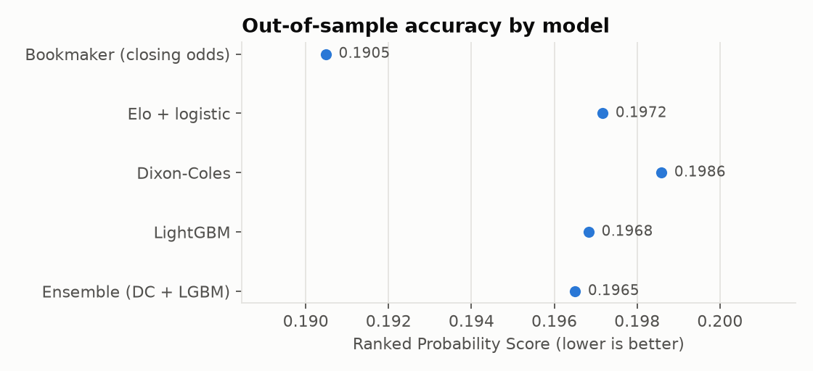
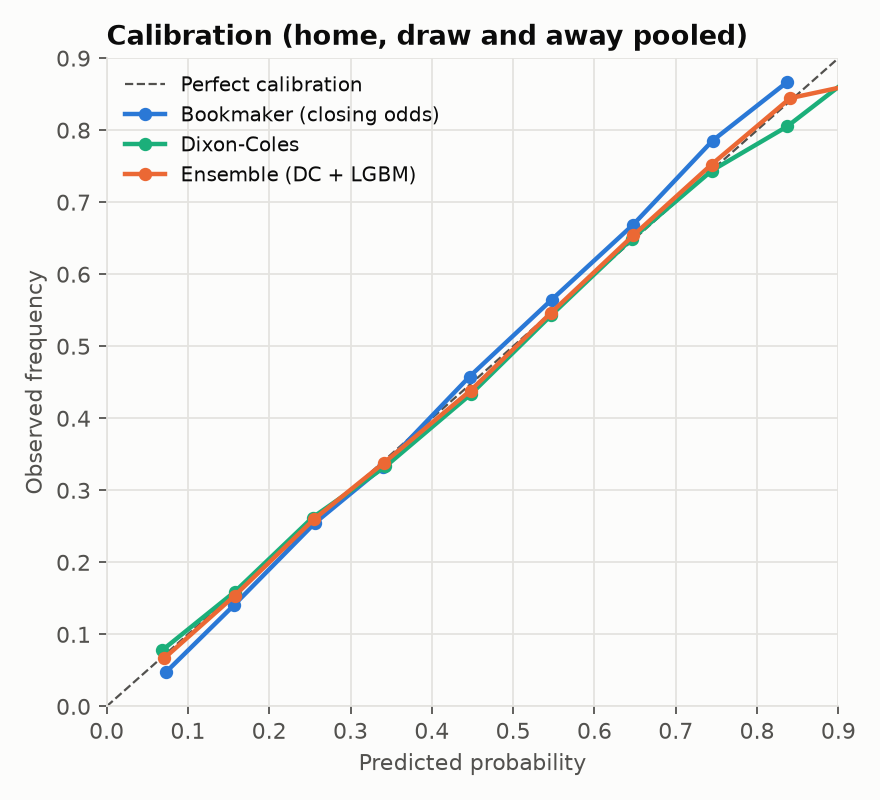

# Football Match Outcome Model - Top 10 European Leagues

[](https://github.com/vladastanko/football-predictor/actions/workflows/tests.yml)


Probabilistic forecasts (home win / draw / away win) for the ten strongest European
football leagues, built as an end-to-end data project: ingestion, data validation,
leak-free feature engineering, four models, a walk-forward backtest against bookmaker
closing odds, and predictions for upcoming fixtures.

**Leagues:** Premier League, La Liga, Serie A, Bundesliga, Ligue 1, Eredivisie,
Primeira Liga, Belgian Pro League, Super Lig, Greek Super League
**Data:** 2012/13 to the current season, 46,000+ matches
**Source:** [football-data.co.uk](https://www.football-data.co.uk) - free, publicly
published CSVs with results, match statistics and bookmaker odds

---

## Results

Walk-forward backtest over four seasons (2022/23 - 2025/26): every season is predicted
by models trained only on earlier seasons. All models are scored on the same
13,061 matches.

| Model | RPS (lower is better) | Log loss | Accuracy |
|---|---:|---:|---:|
| Bookmaker closing odds (benchmark) | 0.1905 | 0.954 | 54.9% |
| **Ensemble (Dixon-Coles + LightGBM)** | **0.1965** | **0.974** | 53.0% |
| LightGBM | 0.1968 | 0.976 | 53.3% |
| Elo + logistic | 0.1972 | 0.976 | 53.1% |
| Dixon-Coles | 0.1986 | 0.982 | 52.9% |

Using only public match data (no line-ups, injuries or market information), the best
model comes within about 3% of the closing-odds RPS, and its probabilities are well
calibrated. Full report: [`reports/evaluation_report.md`](reports/evaluation_report.md),
data checks: [`reports/data_quality.md`](reports/data_quality.md).

<p>
  
  
</p>

---

## Quick start

```bash
python -m venv .venv && source .venv/bin/activate     # Windows: .venv\Scripts\activate
pip install -e ".[dev]"

fpred all          # download -> build -> evaluate -> predict  (first run 5-10 minutes)
```

Outputs land in `reports/`:

| File | Content |
|---|---|
| `evaluation_report.md` | Backtest results, charts, calibration, feature importance |
| `data_quality.md` | Every validation check, flagged rows, coverage per league and season |
| `upcoming_predictions.csv` / `.md` | Probabilities, fair odds and expected goals for upcoming fixtures |
| `scores_overall.csv`, `scores_by_league.csv` | Raw scores for further analysis |

Run the whole pipeline offline on synthetic data (same CSV format) with `fpred demo`,
and the test suite with `pytest` (also run on every push via GitHub Actions).

---

## Pipeline

```
football-data.co.uk CSVs
        │  ingest.py      cached download, polite rate limit, current season refreshed
        ▼
data/raw/{league}/{season}.csv
        │  clean.py       typed schema, two date formats, encoding fallback,
        │                 bookmaker margin removed from odds
        ▼
matches.parquet ──► validate.py   21 checks (structure, consistency, plausibility, market)
        │                         errors fixed or excluded, every fix logged
        ▼
        │  features.py    Elo ratings + rolling form, strictly pre-match
        │  models.py      Dixon-Coles refitted every 28 days, out-of-sample
        ▼
features.parquet
        │  evaluate.py    walk-forward backtest, 5 models, 4 scoring rules
        ▼
reports/  (Markdown report + PNG charts + CSV)
```

## Data quality

Data quality is treated as a first-class step, because one wrong result corrupts
every rating and feature built after it. `validate.py` runs these checks:

| Group | Examples |
|---|---|
| Structure | duplicate matches, missing dates, same team on both sides, a team playing twice on one day |
| Completeness | finished seasons with missing scores, matches without odds |
| Internal consistency | result letter vs score, half-time > full-time goals, shots on target > shots |
| Plausibility | 10+ goal matches, more than five red cards, negative counts |
| Season structure | home/away imbalance (expected only in play-off leagues), rare team names that signal typos or renamed clubs |
| Market data | implied probabilities must sum to 1, bookmaker margin within 0-20% |

Errors are fixed transparently (duplicates removed, impossible shot counts set to
missing, result letter recomputed from the score) and listed in `data_quality.md`.
Warnings are left for human review.

## Features (no look-ahead)

- **Elo ratings** per league: goal-difference weighted updates, home advantage,
  25% regression to the mean between seasons, promoted clubs start below average.
- **Rolling form** over the last 6 matches: goals, shots, shots on target (for and
  against), points, rest days.
- **Dixon-Coles predictions** used as inputs to LightGBM. They come from the
  walk-forward fit, so they are out-of-sample for every row (leak-free stacking).
- Bookmaker odds are **never** used as features; they are only the benchmark.

A test (`test_features_do_not_see_the_future`) reverses every result after a
cut-off date and asserts that no feature before that date changes.

## Models

| Model | Idea |
|---|---|
| Bookmaker closing odds | Benchmark. Pinnacle closing odds where available, margin removed |
| Elo + logistic | Multinomial logistic regression on the Elo difference |
| Dixon-Coles | Poisson goals with team attack/defence strengths, time-decay weights (half-life 1 year) and the Dixon-Coles low-score correction; analytic gradient, L-BFGS |
| LightGBM | Gradient boosting on Elo, form and Dixon-Coles features |
| Ensemble | Average of Dixon-Coles and LightGBM probabilities |

## Evaluation

Walk-forward by season: to score 2024/25, models are trained only on seasons up to
2023/24. All models are compared on exactly the same matches.

- **Ranked Probability Score (RPS)** - standard in football forecasting; respects that
  a draw is "closer" to a home win than an away win is.
- **Log loss** and **Brier score** - proper scoring rules for probabilities.
- **Calibration curves** - when the model says 40%, does it happen 40% of the time?

Bookmaker closing odds aggregate a huge amount of information (team news, injuries,
line-ups) that is not in this dataset, so they are a demanding benchmark. The goal of
this project is a well-calibrated model and an honest comparison, not a claim of
beating the market.

## Player-level data (line-ups, player form, injuries)

Team-level data cannot see that a side is missing its two best players. The
`fpred.players` package adds this from [API-Football](https://www.api-football.com):

```bash
cp .env.example .env          # then put your key in .env (never commit it)
fpred players-collect         # resumable; respects the daily request budget
fpred players                 # link sources, build features, run the experiment
```

- **Collection** - fixtures are fetched 20 per request (line-ups and player stats
  included), so one season costs about 25 requests. Responses are cached, a daily
  budget stops before the plan limit, and a rerun continues where it stopped.
- **Linking the two sources** - team names differ between providers. The team map is
  learned from the data (same day + same score votes), every unmatched team or fixture
  is listed in `reports/player_data_quality.md`, nothing is dropped silently.
- **Features, strictly pre-match** - each player's minute share, goals+assists per 90
  and average rating over the team's previous matches. Aggregated per team into
  *absence* features (known the day before: how much regular playing time and goal
  involvement is injured or suspended) and *confirmed line-up* features (known ~30 min
  before: XI rating, how "usual" the XI is, rotation, debutants).
- **Experiment** - `reports/player_features_report.md` compares team-only, +absences
  and +line-up models on the same matches, with a paired bootstrap 95% interval for the
  change in RPS, so a gain is only claimed when it is distinguishable from noise.

`fpred players-demo` runs the same steps on synthetic API data. There the player
features are random noise by design, and the report correctly shows no improvement.

## Project structure

```
config/config.yaml      leagues, seasons, model and evaluation settings
src/fpred/
  ingest.py             download from football-data.co.uk
  clean.py              parsing, schema, market probabilities
  validate.py           data quality checks and coverage report
  features.py           Elo and rolling form
  models.py             Elo-logit, Dixon-Coles, LightGBM
  evaluate.py           scoring rules, walk-forward backtest
  report.py             charts and Markdown report
  pipeline.py           orchestration
  synthetic.py          synthetic data in the same format (tests and demo)
  players/              API client, collection, source linking, player features, experiment
  cli.py                `fpred` command
tests/                  parsing, leakage, model recovery, scoring rules, end to end
```

## Loading into BigQuery (optional)

```bash
bq mk football
bq load --source_format=PARQUET football.matches  data/processed/matches.parquet
bq load --source_format=PARQUET football.features data/processed/features.parquet
bq load --source_format=PARQUET football.backtest data/processed/backtest_predictions.parquet
```

## Limitations and next steps

- No expected-goals (xG) data yet; player data currently covers the seasons collected via the API.
- Team names are kept as published by the source; a cross-source team ID mapping is
  needed before joining other providers.
- Next: basketball (EuroLeague via its public API), and a live dashboard.

## Data and responsible use

Data comes from football-data.co.uk, which publishes it freely for analysis; please
respect its terms and keep download volume reasonable (the downloader caches files
and pauses between requests). This is an analytics portfolio project, not betting advice.
