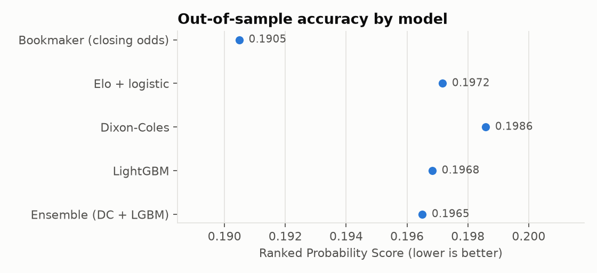
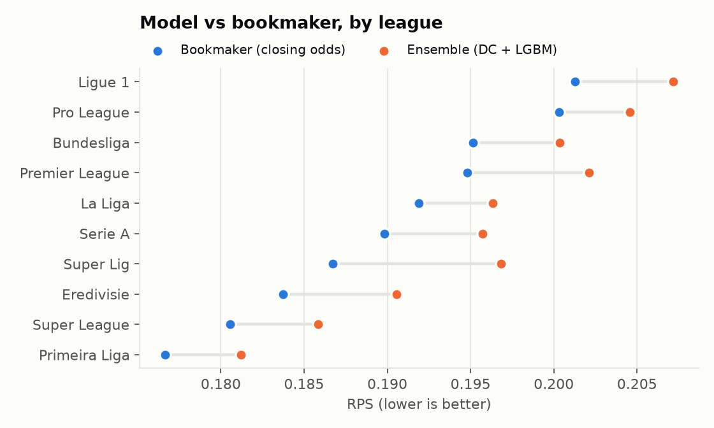
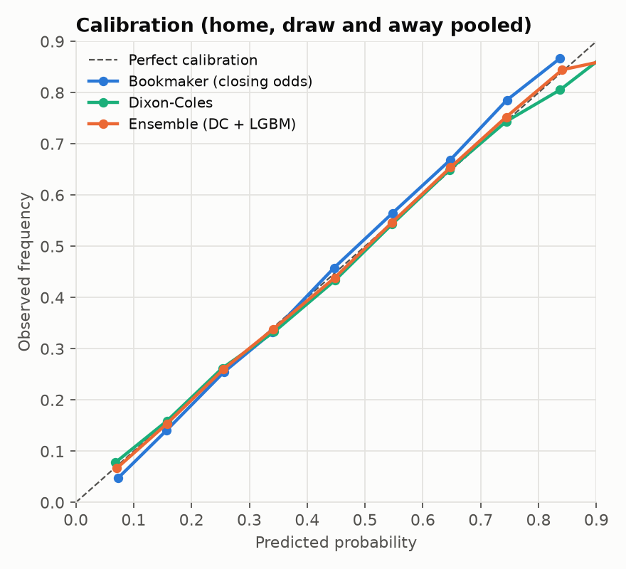
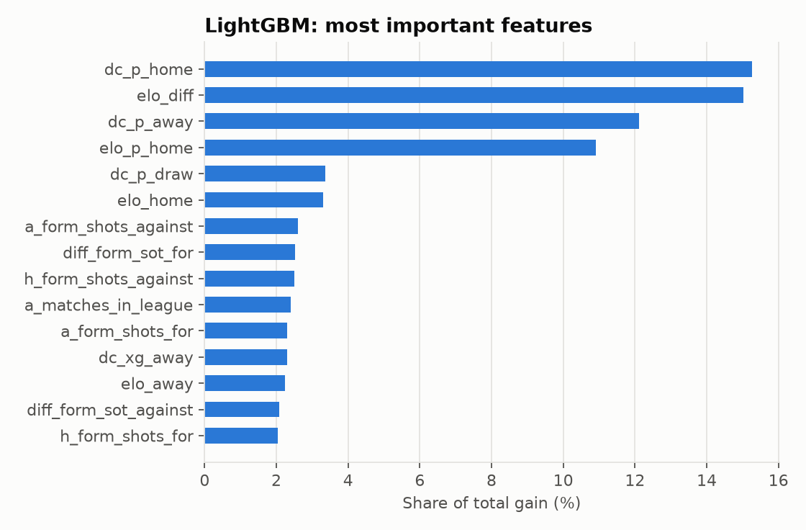

# Evaluation report

Walk-forward backtest: for each test season the models are trained only on earlier
seasons, then scored on every match of that season. All models are compared on the
same 13,061 matches (those with bookmaker closing odds).

**Best own model:** Ensemble (DC + LGBM) - RPS 0.1965
vs bookmaker closing odds RPS 0.1905
(+3.16% relative difference).

## Overall scores

| model                    |    rps |   log_loss |   brier |   accuracy |     n |
|:-------------------------|-------:|-----------:|--------:|-----------:|------:|
| Bookmaker (closing odds) | 0.1905 |     0.954  |  0.5662 |     0.5486 | 13061 |
| Elo + logistic           | 0.1972 |     0.9762 |  0.5811 |     0.5307 | 13061 |
| Dixon-Coles              | 0.1986 |     0.9821 |  0.5837 |     0.5291 | 13061 |
| LightGBM                 | 0.1968 |     0.9755 |  0.5803 |     0.5325 | 13061 |
| Ensemble (DC + LGBM)     | 0.1965 |     0.9735 |  0.579  |     0.5304 | 13061 |

- **RPS** (Ranked Probability Score) is the standard metric for football forecasts; it
  rewards probability mass close to the actual outcome (home > draw > away).
- **Log loss** punishes confident wrong predictions hardest.
- Closing odds are the efficient-market benchmark: matching them is a strong result,
  beating them consistently is rare.

## By season (RPS)

|   season |   Bookmaker (closing odds) |   Elo + logistic |   Dixon-Coles |   LightGBM |   Ensemble (DC + LGBM) |
|---------:|---------------------------:|-----------------:|--------------:|-----------:|-----------------------:|
|     2022 |                     0.1936 |           0.1987 |        0.202  |     0.199  |                 0.1993 |
|     2023 |                     0.184  |           0.1912 |        0.1928 |     0.1925 |                 0.1913 |
|     2024 |                     0.1908 |           0.1988 |        0.2005 |     0.1979 |                 0.198  |
|     2025 |                     0.1936 |           0.2001 |        0.199  |     0.198  |                 0.1974 |

## By league

## Calibration

When the model says 40%, the event should happen about 40% of the time.

## What the model learned

## Data quality summary

- 46,082 played matches, 10 leagues, seasons 2012/13 to 2026/27
- 14/21 checks passed; see `data_quality.md` for details
- Set away shots/shots-on-target to missing in 1 rows where shots on target exceeded total shots.
